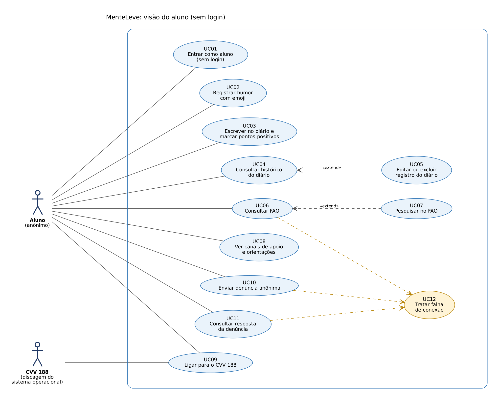
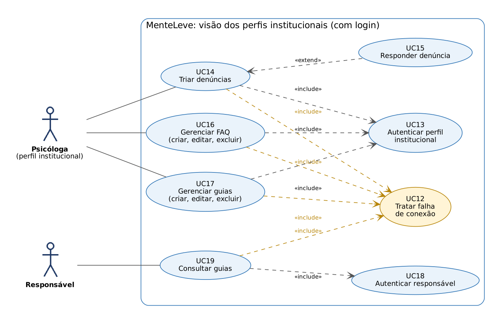

# Diagrama de Casos de Uso

## Atores

| Ator | Descrição | Autenticação |
|---|---|---|
| Aluno | Adolescente de 10 a 17 anos. Usa o app sem login e sem informar dado identificável. | Nenhuma. O app cria uma sessão anônima só para ligar a denúncia ao aparelho. |
| Psicóloga | Perfil institucional (Gestão Educacional). Faz a triagem das denúncias e mantém FAQ e guias. | E-mail institucional e senha, com conta criada pela escola. |
| Responsável | Pai, mãe ou responsável. Lê os guias de orientação. | Número de identificação e senha fornecida pela escola. |
| CVV 188 | Serviço externo acionado pela discagem nativa do sistema operacional. | Não se aplica. |

## Visão do aluno

## Visão dos perfis institucionais

O UC12 (tratar falha de conexão) é incluído por todo caso de uso que lê ou grava no Firestore. Nas imagens ele aparece ligado aos principais.

## Casos de uso e origem

| Código | Caso de uso | Ator | Origem |
|---|---|---|---|
| UC01 | Entrar como aluno (sem login) | Aluno | RNF01. O codinome da tela de entrada fica só no aparelho. |
| UC02 | Registrar humor com emoji | Aluno | RF01, RNF05 (até 3 interações) |
| UC03 | Escrever no diário e marcar pontos positivos | Aluno | RF02 |
| UC04 | Consultar histórico do diário | Aluno | RF06 |
| UC05 | Editar ou excluir registro do diário | Aluno | Protótipo de alta fidelidade (tela Diário Pessoal). O requisitos.md prevê só criar e consultar. |
| UC06 | Consultar FAQ | Aluno | RF04 |
| UC07 | Pesquisar no FAQ | Aluno | Unidade II |
| UC08 | Ver canais de apoio e orientações | Aluno | Seção de funcionalidades do requisitos.md (canais de denúncia e orientação) e aditivo |
| UC09 | Ligar para o CVV 188 | Aluno, CVV 188 | RF03, RNF02 |
| UC10 | Enviar denúncia anônima | Aluno | RF05 |
| UC11 | Consultar resposta da denúncia | Aluno | Complementa RF10. O requisitos.md só descreve a resposta da psicóloga. |
| UC12 | Tratar falha de conexão | Sistema | Unidade II, item (a-iv), e RNF02 |
| UC13 | Autenticar perfil institucional | Psicóloga | RF07 |
| UC14 | Triar denúncias | Psicóloga | RF09 |
| UC15 | Responder denúncia | Psicóloga | RF10 |
| UC16 | Gerenciar FAQ (criar, editar, excluir) | Psicóloga | RF08 |
| UC17 | Gerenciar guias (criar, editar, excluir) | Psicóloga | RF08 e RF11 |
| UC18 | Autenticar responsável | Responsável | RF12, RNF10 |
| UC19 | Consultar guias | Responsável | RF11 |

## Regras de negócio

| Código | Regra | Origem |
|---|---|---|
| RN01 | O aluno não faz login nem informa dado identificável. | Aditivo 2c, RNF01 |
| RN02 | O diário fica só no aparelho, criptografado, e nunca é enviado à nuvem. | Aditivo, Unidade II, RNF03 |
| RN03 | O FAQ vem do Firestore. A leitura é pública e só a psicóloga autenticada escreve. | Unidade II |
| RN04 | O botão do CVV aparece em todas as telas, de forma discreta, e disca sem internet. | Aditivo 4b, Unidade II, RF03 |
| RN05 | O aluno cria a denúncia. Só o autor e a psicóloga leem. Só a psicóloga responde. | Decisão do grupo (a validar com a professora) |
| RN06 | Psicóloga e responsável entram com credenciais criadas pela escola, fora do app. Os guias só abrem para esses dois perfis. | RF07, RF12, RNF10 |
| RN07 | Sem conexão, a denúncia fica marcada como aguardando envio e é enviada sozinha quando a internet volta. O FAQ usa o cache local. | Unidade II (a-iv) |
| RN08 | O app não coleta IP, localização nem dados do aparelho. Não usa ferramentas de analytics. | Unidade II |
| RN09 | O registro de humor se faz em até 3 interações: abrir, tocar no emoji, salvar. | RNF05 |
| RN10 | O modo escuro segue a configuração do sistema. | Unidade II, RNF08 |
