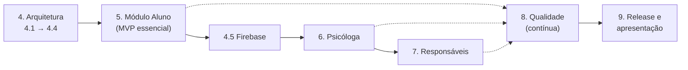

# EAP / WBS Simplificada — MenteLeve

> **Estrutura Analítica do Projeto (EAP)**, em inglês *Work Breakdown Structure (WBS)*: decomposição hierárquica de **todas as entregas** do aplicativo MenteLeve em pacotes de trabalho verificáveis.
>
> **Fontes:** [`estudo-de-caso.md`](estudo-de-caso.md), [`requisitos.md`](requisitos.md), [`funcionalidades.md`](funcionalidades.md), [`personas.md`](personas.md), [`justificativas.md`](justificativas.md) e [`CHANGELOG.md`](../CHANGELOG.md).
>
> **Numeração dos requisitos:** segue a lista final de *Requisitos Funcionais (RF01–RF12)* e *Requisitos Não Funcionais (RNF01–RNF10)* da seção 1 e 2 de `requisitos.md`.

---

## 1. Visão geral

| Item                | Definição                                                                                                  |
| ------------------- | ---------------------------------------------------------------------------------------------------------- |
| **Produto**         | App mobile em Flutter de acolhimento emocional anônimo para adolescentes de 10 a 17 anos                   |
| **Usuário central** | Aluno (sem login, dados apenas no dispositivo)                                                             |
| **Usuários de apoio** | Psicóloga escolar / equipe pedagógica e pais/responsáveis (login restrito)                              |
| **Plataforma-alvo** | Android 7.0+ (API 24+), com compatibilidade iOS (RNF04)                                                    |
| **Persistência**    | Local (SQLite) para o diário; Firebase apenas para conteúdo estático e denúncias anônimas (RNF03, RNF09)  |
| **Níveis da EAP**   | Nível 0 (produto) → Nível 1 (fases/módulos) → Nível 2 (entregas) → Nível 3 (pacotes de trabalho)           |

---

## 2. EAP visual

> O diagrama abaixo é renderizado automaticamente pelo GitHub (Mermaid). Versão em imagem: [`eap.png`](eap.png).

```mermaid
flowchart LR
    ROOT["<b>0. MenteLeve</b><br/>App de acolhimento emocional"]

    ROOT --> G1["<b>1. Gerenciamento</b><br/>do Projeto"]
    ROOT --> G2["<b>2. Concepção e</b><br/>Documentação"]
    ROOT --> G3["<b>3. Design</b><br/>UI/UX"]
    ROOT --> G4["<b>4. Arquitetura e</b><br/>Infraestrutura"]
    ROOT --> G5["<b>5. Módulo</b><br/>Aluno"]
    ROOT --> G6["<b>6. Módulo</b><br/>Psicóloga Escolar"]
    ROOT --> G7["<b>7. Módulo</b><br/>Pais e Responsáveis"]
    ROOT --> G8["<b>8. Qualidade e</b><br/>Homologação"]
    ROOT --> G9["<b>9. Implantação e</b><br/>Encerramento"]

    G1 --> G1a["1.1 Planejamento e EAP"]
    G1 --> G1b["1.2 Cronograma e responsabilidades"]
    G1 --> G1c["1.3 Controle de versão e CHANGELOG"]

    G2 --> G2a["2.1 Estudo de caso"]
    G2 --> G2b["2.2 Pesquisa e benchmark"]
    G2 --> G2c["2.3 Personas"]
    G2 --> G2d["2.4 Funcionalidades e requisitos"]
    G2 --> G2e["2.5 Apresentações da Unidade I"]

    G3 --> G3a["3.1 Protótipo de baixa fidelidade"]
    G3 --> G3b["3.2 Protótipo de alta fidelidade"]
    G3 --> G3c["3.3 Design system e justificativas"]
    G3 --> G3d["3.4 Ilustrações e mascote"]

    G4 --> G4a["4.1 Setup do projeto Flutter"]
    G4 --> G4b["4.2 Arquitetura e navegação"]
    G4 --> G4c["4.3 Tema e componentes base"]
    G4 --> G4d["4.4 Persistência local (SQLite)"]
    G4 --> G4e["4.5 Integração Firebase"]

    G5 --> G5a["5.1 Onboarding e codinome"]
    G5 --> G5b["5.2 Registro rápido de emoções · RF01"]
    G5 --> G5c["5.3 Diário reflexivo e pontos positivos · RF02"]
    G5 --> G5d["5.4 Histórico local · RF06"]
    G5 --> G5e["5.5 Mascote de acolhimento"]
    G5 --> G5f["5.6 Botão de emergência CVV 188 · RF03"]
    G5 --> G5g["5.7 FAQ educativo · RF04"]
    G5 --> G5h["5.8 Denúncia anônima · RF05"]

    G6 --> G6a["6.1 Autenticação institucional · RF07"]
    G6 --> G6b["6.2 Gestão de conteúdos · RF08"]
    G6 --> G6c["6.3 Triagem de denúncias · RF09"]
    G6 --> G6d["6.4 Resposta à queixa · RF10"]

    G7 --> G7a["7.1 Cadastro backoffice · RNF10"]
    G7 --> G7b["7.2 Autenticação do responsável · RF12"]
    G7 --> G7c["7.3 Conteúdos informativos · RF11"]

    G8 --> G8a["8.1 Análise estática (flutter analyze)"]
    G8 --> G8b["8.2 Testes unitários e de widget"]
    G8 --> G8c["8.3 Testes em emulador Android API 24+"]
    G8 --> G8d["8.4 Testes de RNF (offline, 3 toques, tamanho)"]

    G9 --> G9a["9.1 Build de release (APK/AAB)"]
    G9 --> G9b["9.2 Documentação final e README"]
    G9 --> G9c["9.3 Apresentação final"]

    classDef root fill:#00A6F4,stroke:#0069A8,color:#fff;
    classDef l1 fill:#0084D1,stroke:#0069A8,color:#fff;
    classDef wp fill:#FAFAFA,stroke:#9F9FA9,color:#09090B;
    class ROOT root;
    class G1,G2,G3,G4,G5,G6,G7,G8,G9 l1;
    class G1a,G1b,G1c,G2a,G2b,G2c,G2d,G2e,G3a,G3b,G3c,G3d,G4a,G4b,G4c,G4d,G4e,G5a,G5b,G5c,G5d,G5e,G5f,G5g,G5h,G6a,G6b,G6c,G6d,G7a,G7b,G7c,G8a,G8b,G8c,G8d,G9a,G9b,G9c wp;
```



---

## 3. EAP textual (estrutura hierárquica)

```text
0. MenteLeve
├── 1. Gerenciamento do Projeto
│   ├── 1.1 Planejamento e EAP (este documento)
│   ├── 1.2 Cronograma e matriz de responsabilidades
│   └── 1.3 Controle de versão (GitHub, Conventional Commits) e CHANGELOG
├── 2. Concepção e Documentação
│   ├── 2.1 Análise do estudo de caso
│   ├── 2.2 Pesquisa do problema e benchmark
│   ├── 2.3 Personas (aluno, psicóloga, responsável)
│   ├── 2.4 Funcionalidades, requisitos (RF/RNF), CRUD e priorização
│   └── 2.5 Apresentações (requisitos e final da Unidade I)
├── 3. Design UI/UX
│   ├── 3.1 Protótipo de baixa fidelidade
│   ├── 3.2 Protótipo de alta fidelidade (Figma)
│   ├── 3.3 Design system e justificativas (cores, tipografia, navegação)
│   └── 3.4 Ilustrações, emojis e mascote
├── 4. Arquitetura e Infraestrutura
│   ├── 4.1 Setup do projeto Flutter (minSdk 24, lints, estrutura de pastas)
│   ├── 4.2 Arquitetura em camadas e navegação (abas + rotas por perfil)
│   ├── 4.3 Tema (paleta sky/zinc, Poppins/Noto Sans, modo noturno) e componentes base
│   ├── 4.4 Persistência local (SQLite) para diário e codinome
│   └── 4.5 Integração Firebase (conteúdo estático, denúncias, autenticação)
├── 5. Módulo Aluno (sem login)
│   ├── 5.1 Onboarding e escolha de codinome
│   ├── 5.2 Registro rápido de emoções por emoji — RF01
│   ├── 5.3 Diário reflexivo e checklist de pontos positivos — RF02
│   ├── 5.4 Histórico local do diário e resumo semanal — RF06
│   ├── 5.5 Mascote de acolhimento (mensagens por humor + encaminhamento ao CVV)
│   ├── 5.6 Botão fixo de emergência CVV 188 (offline) — RF03
│   ├── 5.7 FAQ educativo sobre bullying e saúde mental — RF04
│   └── 5.8 Canais de denúncia e envio de queixa anônima — RF05
├── 6. Módulo Psicóloga Escolar / Equipe Pedagógica
│   ├── 6.1 Autenticação institucional (e-mail + senha) — RF07
│   ├── 6.2 Painel de publicação e atualização de conteúdos/FAQ — RF08
│   ├── 6.3 Painel de triagem de denúncias e queixas — RF09
│   └── 6.4 Resposta, acolhimento e status da queixa — RF10
├── 7. Módulo Pais e Responsáveis
│   ├── 7.1 Cadastro prévio de responsáveis no backoffice — RNF10
│   ├── 7.2 Autenticação do responsável (ID + senha da escola) — RF12
│   └── 7.3 Guias e conteúdos informativos — RF11
├── 8. Qualidade e Homologação (UNIT)
│   ├── 8.1 Análise estática sem warnings críticos (flutter analyze)
│   ├── 8.2 Testes unitários e de widget
│   ├── 8.3 Testes manuais no emulador Android API 24+ (Android 7.0+)
│   └── 8.4 Verificação dos RNF (offline, 3 interações, 4–8 telas, 50–300 MB, anonimato)
└── 9. Implantação e Encerramento
    ├── 9.1 Build de release assinado (APK/AAB)
    ├── 9.2 Documentação final (README, CHANGELOG, manual de uso)
    └── 9.3 Apresentação final e entrega da disciplina
```

---

## 4. Dicionário da EAP

Legenda de prioridade (seção 4 de `requisitos.md`): **E** = Essencial · **I** = Importante · **S** = Secundária · **—** = suporte/gestão.
Legenda de status: ✅ Concluído · 🔄 Em andamento · ⏳ Pendente.

### 1. Gerenciamento do Projeto

| ID  | Pacote de trabalho             | Descrição / entregável                                                        | Critério de aceite                                                              | Prior. | Status |
| --- | ------------------------------ | ----------------------------------------------------------------------------- | ------------------------------------------------------------------------------- | :----: | :----: |
| 1.1 | Planejamento e EAP             | `docs/eap.md` com EAP visual, textual e dicionário                            | Cobre todas as entregas do app e está arquivada em `docs/eap.md`                |   —    |   ✅   |
| 1.2 | Cronograma e responsabilidades | Tabela de integrantes × responsabilidades no README e marcos por unidade      | Cada pacote da EAP possui responsável definido                                  |   —    |   🔄   |
| 1.3 | Controle de versão             | Repositório GitHub, commits em Conventional Commits, `CHANGELOG.md` atualizado | Commits individuais rastreáveis por integrante; CHANGELOG atualizado por marco  |   —    |   🔄   |

### 2. Concepção e Documentação

| ID  | Pacote de trabalho            | Descrição / entregável                                      | Critério de aceite                                   | Prior. | Status |
| --- | ----------------------------- | ----------------------------------------------------------- | ---------------------------------------------------- | :----: | :----: |
| 2.1 | Estudo de caso                | `docs/estudo-de-caso.md`                                    | Objetivo, problema, público e restrições definidos   |   —    |   ✅   |
| 2.2 | Pesquisa e benchmark          | `docs/pesquisa.md`, `docs/benchmark.md`                     | Dados do problema e apps concorrentes analisados     |   —    |   ✅   |
| 2.3 | Personas                      | `docs/personas.md`                                          | Uma persona por perfil de usuário                    |   —    |   ✅   |
| 2.4 | Funcionalidades e requisitos  | `docs/funcionalidades.md`, `docs/requisitos.md`             | RF, RNF, CRUD e priorização documentados             |   —    |   ✅   |
| 2.5 | Apresentações da Unidade I    | `docs/apresentacaoRequisitos.pdf`, `docs/apresentacaoFinalUnidadeI.pdf` | Apresentadas em sala                     |   —    |   ✅   |

### 3. Design UI/UX

| ID  | Pacote de trabalho                | Descrição / entregável                                                 | Critério de aceite                                                    | Prior. | Status |
| --- | --------------------------------- | ---------------------------------------------------------------------- | --------------------------------------------------------------------- | :----: | :----: |
| 3.1 | Protótipo de baixa fidelidade     | `docs/prototipoBaixaFidelidade.pdf`                                    | Fluxos principais dos três perfis desenhados                         |   —    |   ✅   |
| 3.2 | Protótipo de alta fidelidade      | `docs/prototipoAltaFidelidade.pdf` (Figma)                             | Telas de onboarding, multi-login, auth e home finalizadas             |   —    |   ✅   |
| 3.3 | Design system e justificativas    | `docs/justificativas.md` (tokens de cor, tipografia, navegação)        | Tokens documentados e aderentes ao RNF08                              |   —    |   ✅   |
| 3.4 | Ilustrações, emojis e mascote     | Assets otimizados (SVG/WebP) do mascote e dos emojis de humor          | Assets leves, legíveis em tela pequena e no modo noturno              |   E    |   ⏳   |

### 4. Arquitetura e Infraestrutura

| ID  | Pacote de trabalho        | Descrição / entregável                                                                  | Critério de aceite                                                                  | RF/RNF            | Prior. | Status |
| --- | ------------------------- | --------------------------------------------------------------------------------------- | ----------------------------------------------------------------------------------- | ----------------- | :----: | :----: |
| 4.1 | Setup Flutter             | Projeto criado, `minSdkVersion 24`, `analysis_options.yaml` com `flutter_lints`         | `flutter analyze` sem erros; app abre no emulador API 24                            | RNF04             |   E    |   ⏳   |
| 4.2 | Arquitetura e navegação   | Camadas (UI / domínio / dados), rotas por perfil, barra inferior com 4 abas            | Total de telas principais entre 4 e 8; profundidade máx. de 2 níveis               | RNF06             |   E    |   ⏳   |
| 4.3 | Tema e componentes base   | `ThemeData` claro/escuro com a paleta do Figma, fontes Poppins/Noto Sans, botões, cards | Componentes reutilizados em todas as telas; modo noturno funcional                 | RNF08             |   E    |   ⏳   |
| 4.4 | Persistência local        | Banco SQLite (ex.: `sqflite`/`drift`) para emoções, diário, checklist e codinome        | Dados do diário nunca enviados à rede; leitura/escrita funcionam offline           | RNF02, RNF03      |   E    |   ⏳   |
| 4.5 | Integração Firebase       | Firestore para FAQ/mensagens/denúncias, Firebase Auth para perfis institucionais, cache offline | Nenhum dado do diário no Firebase; conteúdo estático disponível em cache offline | RNF01, RNF09      |   I    |   ⏳   |

### 5. Módulo Aluno

| ID  | Pacote de trabalho              | Descrição / entregável                                                                     | Critério de aceite                                                                              | RF/RNF              | Prior. | Status |
| --- | ------------------------------- | ------------------------------------------------------------------------------------------ | ----------------------------------------------------------------------------------------------- | ------------------- | :----: | :----: |
| 5.1 | Onboarding e codinome           | Tela de entrada, CTA do aluno e escolha de codinome salvo localmente                       | Nenhum dado identificável solicitado; codinome persiste após reabrir o app                     | RNF01               |   E    |   ⏳   |
| 5.2 | Registro rápido de emoções      | Seletor de emojis grandes na home, salvando emoji + data/hora (CREATE)                    | Registro concluído em até 3 interações (abrir → emoji → salvar), inclusive offline             | RF01, RNF05         |   E    |   ⏳   |
| 5.3 | Diário reflexivo e positivos    | Escrita livre e checklist de pontos positivos do dia (CREATE)                              | Texto e checklist salvos localmente; funcionam sem internet                                    | RF02, RNF03         |   E    |   ⏳   |
| 5.4 | Histórico local                 | Lista/timeline de registros anteriores e resumo semanal da home (READ)                    | Registros exibidos em ordem cronológica, lidos apenas do dispositivo                           | RF06, RNF03         |   I    |   ⏳   |
| 5.5 | Mascote de acolhimento          | Personagem que reage ao humor registrado com mensagens validadas e sugere o CVV em humores críticos | Mensagem exibida após cada registro; sequência de humores negativos exibe encaminhamento ao CVV 188 | Estudo de caso | E | ⏳ |
| 5.6 | Botão de emergência CVV 188     | Pill button fixo que abre o discador com `tel:188`                                         | Visível nas telas do aluno; aciona com 1 toque; funciona em modo avião (sem dados)             | RF03, RNF02         |   E    |   ⏳   |
| 5.7 | FAQ educativo                   | Lista de perguntas e respostas acolhedoras (READ), com cache local                        | Conteúdo exibido online e offline (após primeira sincronização)                                | RF04, RNF09         |   E    |   ⏳   |
| 5.8 | Canais de denúncia e queixa     | Lista de canais oficiais e formulário de denúncia anônima (CREATE)                        | Envio sem login nem dado identificável; fila local quando offline e envio ao reconectar        | RF05, RNF01         |   E    |   ⏳   |

### 6. Módulo Psicóloga Escolar

| ID  | Pacote de trabalho           | Descrição / entregável                                                 | Critério de aceite                                                     | RF/RNF | Prior. | Status |
| --- | ---------------------------- | ---------------------------------------------------------------------- | ---------------------------------------------------------------------- | ------ | :----: | :----: |
| 6.1 | Autenticação institucional   | Login por e-mail institucional + senha via bottom sheet de multi-login | Acesso negado a credenciais não cadastradas; logout disponível        | RF07   |   I    |   ⏳   |
| 6.2 | Gestão de conteúdos          | CRUD de itens do FAQ e mensagens de apoio (CREATE/READ/UPDATE)         | Conteúdo publicado aparece no app do aluno após sincronização         | RF08   |   I    |   ⏳   |
| 6.3 | Triagem de denúncias         | Painel com lista, filtros e detalhes das denúncias anônimas (READ)     | Todas as denúncias enviadas aparecem, sem dados que identifiquem o aluno | RF09 |   I    |   ⏳   |
| 6.4 | Resposta à queixa            | Registro de resposta e mudança de status pendente → respondida (CREATE/UPDATE) | Status atualizado no painel; resposta vinculada à denúncia      | RF10   |   I    |   ⏳   |

### 7. Módulo Pais e Responsáveis

| ID  | Pacote de trabalho          | Descrição / entregável                                                 | Critério de aceite                                                     | RF/RNF | Prior. | Status |
| --- | --------------------------- | ---------------------------------------------------------------------- | ---------------------------------------------------------------------- | ------ | :----: | :----: |
| 7.1 | Cadastro backoffice         | Cadastro prévio dos responsáveis feito pela escola fora do app (ex.: console Firebase/planilha de importação) | Responsáveis não conseguem se autocadastrar pelo app | RNF10 |   S    |   ⏳   |
| 7.2 | Autenticação do responsável | Login por número de identificação + senha fornecida pela escola       | Somente credenciais pré-cadastradas acessam o painel                   | RF12   |   S    |   ⏳   |
| 7.3 | Conteúdos informativos      | Guias e artigos sobre sinais de alerta, bullying e prevenção (READ)   | Conteúdos exibidos após login, gerenciáveis pela psicóloga (6.2)      | RF11   |   S    |   ⏳   |

### 8. Qualidade e Homologação (UNIT)

| ID  | Pacote de trabalho                | Descrição / entregável                                                        | Critério de aceite                                                                    | Status |
| --- | --------------------------------- | ----------------------------------------------------------------------------- | ------------------------------------------------------------------------------------- | :----: |
| 8.1 | Análise estática                  | Execução de `flutter analyze` a cada entrega                                  | Compilação limpa, sem erros nem warnings críticos                                    |   ⏳   |
| 8.2 | Testes unitários e de widget      | `flutter test` cobrindo repositórios locais, regras do mascote e telas-chave | Todos os testes passando antes do merge                                               |   ⏳   |
| 8.3 | Testes em emulador Android        | Roteiro manual em AVD com API 24 (Android 7.0) e uma API recente             | Todos os fluxos dos módulos 5, 6 e 7 executados sem falhas                            |   ⏳   |
| 8.4 | Verificação dos RNF               | Checklist: modo avião, contagem de toques, número de telas, tamanho do APK, ausência de dados pessoais | Todos os itens RNF01–RNF10 marcados como atendidos             |   ⏳   |

### 9. Implantação e Encerramento

| ID  | Pacote de trabalho      | Descrição / entregável                                         | Critério de aceite                                               | Status |
| --- | ----------------------- | -------------------------------------------------------------- | ---------------------------------------------------------------- | :----: |
| 9.1 | Build de release        | `flutter build apk --release` (e AAB) assinado                 | APK instala e executa no emulador API 24; tamanho entre 50 e 300 MB (RNF07) | ⏳ |
| 9.2 | Documentação final      | README com instruções de build, CHANGELOG e manual de uso     | Qualquer integrante consegue rodar o projeto seguindo o README  |   ⏳   |
| 9.3 | Apresentação final      | Slides e demonstração do app funcionando                       | Apresentado e entregue na data da disciplina                     |   ⏳   |

---

## 5. Matriz de rastreabilidade (Requisitos × EAP)

Garante que **todo requisito tem ao menos um pacote de trabalho** que o entrega.

| Requisito | Descrição resumida                              | Pacote(s) da EAP     |
| --------- | ----------------------------------------------- | -------------------- |
| RF01      | Registro rápido de emoções                      | 5.2                  |
| RF02      | Diário reflexivo e pontos positivos             | 5.3                  |
| RF03      | Discagem rápida CVV 188                         | 5.6                  |
| RF04      | FAQ educativo                                   | 5.7, 6.2             |
| RF05      | Envio de queixas e denúncias anônimas           | 5.8, 4.5             |
| RF06      | Histórico local do diário                       | 5.4, 4.4             |
| RF07      | Autenticação institucional                      | 6.1, 4.5             |
| RF08      | Publicação e atualização de conteúdos           | 6.2                  |
| RF09      | Painel de triagem de denúncias                  | 6.3                  |
| RF10      | Resposta e acolhimento à queixa                 | 6.4                  |
| RF11      | Conteúdos informativos para responsáveis        | 7.3                  |
| RF12      | Autenticação de responsável                     | 7.2, 7.1             |
| RNF01     | Anonimato total do aluno                        | 5.1, 5.8, 4.5, 8.4   |
| RNF02     | Arquitetura offline first                       | 4.4, 5.2, 5.6, 8.4   |
| RNF03     | Armazenamento local de dados sensíveis          | 4.4, 5.3, 5.4        |
| RNF04     | Android 7.0+ e iOS                              | 4.1, 8.3             |
| RNF05     | Função central em até 3 interações              | 5.2, 8.4             |
| RNF06     | Interface com 4 a 8 telas                       | 4.2, 8.4             |
| RNF07     | Tamanho 50–300 MB e animações leves             | 3.4, 9.1             |
| RNF08     | Identidade visual suave e modo noturno          | 3.3, 4.3             |
| RNF09     | Nuvem apenas para conteúdo estático             | 4.5, 5.7             |
| RNF10     | Cadastro backoffice de responsáveis             | 7.1                  |

---

## 6. Sequência de entrega sugerida

A ordem segue a priorização de `requisitos.md` (Essenciais → Importantes → Secundárias) e as dependências técnicas entre pacotes.



| Marco | Conteúdo                                                        | Pacotes                         |
| ----- | --------------------------------------------------------------- | ------------------------------- |
| M1    | Base do app rodando no emulador API 24                          | 4.1, 4.2, 4.3, 4.4              |
| M2    | MVP do aluno 100% offline (emoções, diário, CVV, mascote)       | 3.4, 5.1–5.6                    |
| M3    | Conteúdo em nuvem (FAQ, denúncias)                              | 4.5, 5.7, 5.8                   |
| M4    | Backoffice da psicóloga                                         | 6.1–6.4                         |
| M5    | Área dos responsáveis                                           | 7.1–7.3                         |
| M6    | Homologação e entrega final                                     | 8.1–8.4, 9.1–9.3                |

---

## 7. Definition of Done (DoD) aplicável a todo pacote de código

Um pacote de trabalho dos grupos 4 a 9 só é considerado **concluído** quando:

1. **Compila sem warnings críticos** — `flutter analyze` sem erros ou avisos de severidade *warning*.
2. **Foi testado no emulador Android API 24+ (Android 7.0+)**, além de uma versão recente do Android.
3. **Está rastreável no GitHub** — commits individuais do responsável seguindo [Conventional Commits](https://www.conventionalcommits.org/pt-br/), por exemplo:
   - `feat(aluno): adiciona registro rápido de emoções (RF01)`
   - `fix(cvv): garante discagem 188 em modo avião`
   - `docs: atualiza eap com status do marco M2`
   - `test(diario): cobre repositório local do diário reflexivo`
4. Atende ao **critério de aceite** do dicionário (seção 4) e aos RNF vinculados.
5. Teve o **status atualizado** neste documento e no `CHANGELOG.md`.
