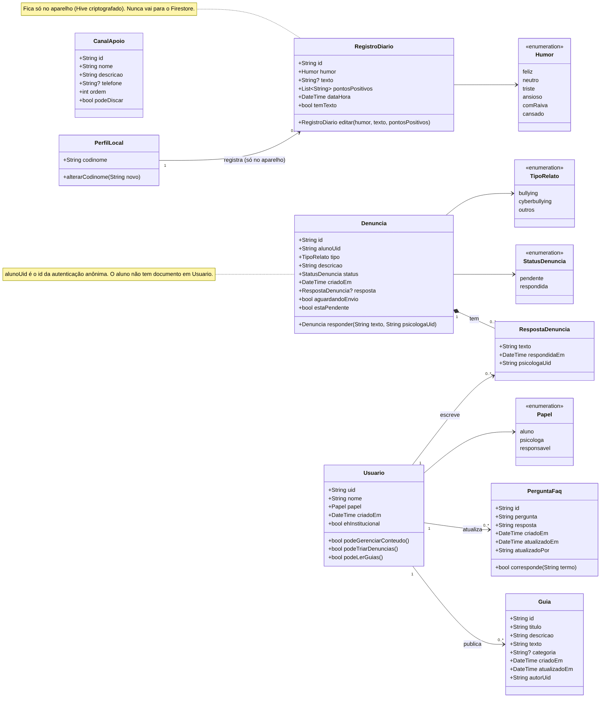
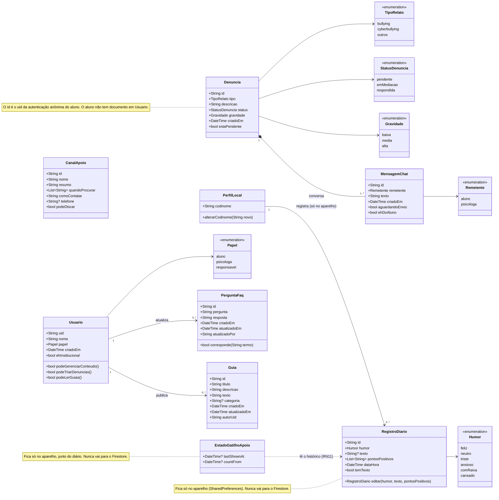

# Diagrama de Classes (modelos de domínio)

Entidades principais do MenteLeve, com atributos, métodos e relacionamentos.

Código-fonte do diagrama:

> A imagem `diagrama-de-classes.png` está desatualizada: ainda mostra `RespostaDenuncia` e não mostra `MensagemChat`, `Gravidade` nem `EstadoGatilhoApoio`. O código-fonte Mermaid acima é a versão atual.

O diagrama usa nomes em português para descrever o domínio. No código, as classes e os campos gravados no Firestore estão em inglês. A coluna "Classe em Dart" da tabela abaixo liga os dois.

## Descrição das classes

| Classe | Classe em Dart | Papel no sistema | Onde é guardada | Requisitos |
|---|---|---|---|---|
| Usuario | `UserModel` | Psicóloga ou responsável autenticado. Define o que cada perfil pode fazer. | Firestore, coleção `users` | RF07, RF12 |
| PerfilLocal | `LocalUserModel` | Codinome e avatar escolhidos pelo aluno na entrada. | Aparelho (SharedPreferences, chave `profile`) | RNF01 |
| RegistroDiario | `RegistroDiario` | Um registro do aluno: humor com emoji, texto opcional e pontos positivos opcionais. | Aparelho (SharedPreferences, chave `diario`) | RF01, RF02, RF06 |
| Denuncia | `Report` | Relato anônimo do aluno, aberto pela primeira mensagem do chat. É o que a psicóloga vê na triagem. | Firestore, documento `reports/{uid}` | RF05, RF09 |
| MensagemChat | `ChatMessage` | Mensagem da conversa entre o aluno e a psicóloga, em tempo real. A resposta da psicóloga é uma mensagem com remetente `psychologist`. | Firestore, subcoleção `reports/{uid}/messages` | RF05, RF10 |
| PerguntaFaq | `FaqModel` | Pergunta e resposta do FAQ. | Firestore, coleção `faq`, com cópia no aparelho (`faq_cache`) | RF04, RF08 |
| Guia | `GuideModel` | Material de orientação para os responsáveis. | Firestore, coleção `guides`, com cópia no aparelho (`guides_cache`) | RF08, RF11 |
| CanalApoio | `OfficialChannel` | Canal de ajuda externo (Disque 100, Conselho Tutelar, Ouvidoria Escolar). O CVV 188 tem botão próprio (`CvvButton`). | Lista fixa no app (`officialChannels`), sem banco | RF06 |
| EstadoGatilhoApoio | `SupportTriggerState` | Controle do modal de apoio por sofrimento intenso: quando apareceu pela última vez (`lastShownAt`) e a partir de quando a sequência volta a contar (`countFrom`). Não identifica o aluno nem guarda o humor. | Aparelho, junto do diário (chave `support_trigger_state`) | RN11 (UC20) |

Enums: `Papel` (`Role`: student, parent, psychologist), `Humor` (feliz, neutro, triste, ansioso, comRaiva, cansado), `TipoRelato` (`ReportType`: bullying, cyberbullying, other), `StatusDenuncia` (`ReportStatus`: pending, inMediation, answered), `Gravidade` (`ReportSeverity`: low, medium, high) e `Remetente` (`ChatSender`: student, psychologist).

## Decisões de modelagem

- O aluno não tem classe de usuário no Firestore. O id da denúncia é o `uid` da autenticação anônima, e o documento guarda o mesmo valor em `studentUid`. O painel de triagem nunca lê esse campo. O codinome nunca sai do aparelho.
- Cada aluno tem uma única conversa. A primeira mensagem cria a denúncia e as seguintes entram em `messages`. A resposta da psicóloga deixou de ser um campo da denúncia e passou a ser uma mensagem da conversa (RF10).
- `RegistroDiario` reúne humor, texto e pontos positivos em uma classe só. Assim o registro rápido por emoji (RF01) e o diário escrito (RF02) usam a mesma estrutura, e o texto e os pontos positivos são opcionais.
- `aguardandoEnvio` em `MensagemChat` não é gravado. Vem de `metadata.hasPendingWrites` e mostra "Enviando…" quando o aluno está sem internet.
- `gravidade` é opcional no documento. Quando falta, o app estima pelo tipo e pelo texto do relato (`ReportSeverity.infer`).
- `CanalApoio` não tem tela de edição nem coleção no Firestore: a lista é fixa no código.
- Os valores dos enums são gravados como texto, usando o nome do enum em inglês.
