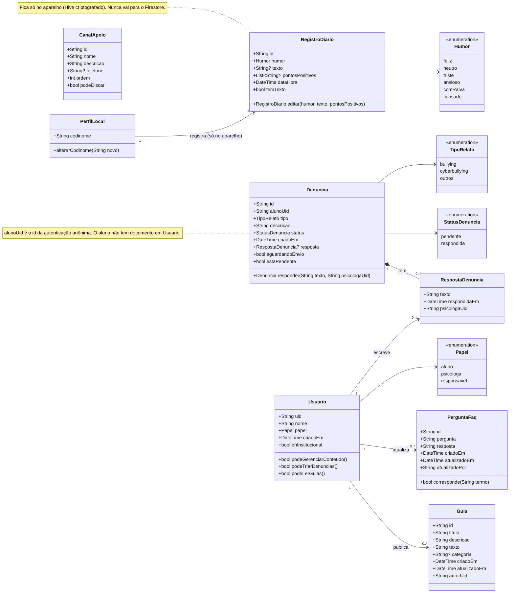
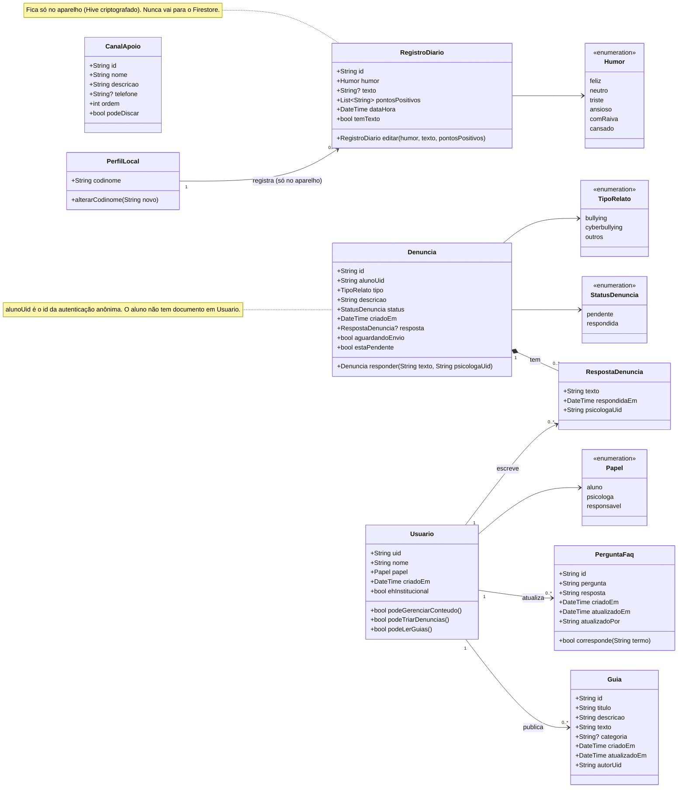

# Diagrama de Classes (modelos de domínio)

Entidades principais do MenteLeve, com atributos, métodos e relacionamentos.

Código-fonte do diagrama:

## Descrição das classes

| Classe | Papel no sistema | Onde é guardada | Requisitos |
|---|---|---|---|
| Usuario | Psicóloga ou responsável autenticado. Define o que cada perfil pode fazer. | Firestore, coleção `usuarios` | RF07, RF12 |
| PerfilLocal | Codinome escolhido pelo aluno na entrada. | Aparelho (Hive) | RNF01 |
| RegistroDiario | Um registro do aluno: humor com emoji, texto opcional e pontos positivos opcionais. | Aparelho (Hive criptografado) | RF01, RF02, RF06 |
| Denuncia | Relato anônimo enviado pelo aluno à escola. | Firestore, coleção `denuncias` | RF05, RF09 |
| RespostaDenuncia | Resposta da psicóloga. Fica dentro da denúncia. | Campo `resposta` da denúncia | RF10 |
| PerguntaFaq | Pergunta e resposta do FAQ. | Firestore, coleção `faq` | RF04, RF08 |
| Guia | Material de orientação para os responsáveis. | Firestore, coleção `guias` | RF08, RF11 |
| CanalApoio | Canal de ajuda externo (CVV, Disque 100, Ouvidoria). | Firestore, coleção `canais` | RF04 |

Enums: `Papel` (aluno, psicologa, responsavel), `Humor` (feliz, neutro, triste, ansioso, comRaiva, cansado), `TipoRelato` (bullying, cyberbullying, outros) e `StatusDenuncia` (pendente, respondida).

## Decisões de modelagem

- O aluno não tem classe de usuário no Firestore. A denúncia guarda só o `alunoUid`, que é o identificador da autenticação anônima. O codinome nunca sai do aparelho.
- `RegistroDiario` reúne humor, texto e pontos positivos em uma classe só. Assim o registro rápido por emoji (RF01) e o diário escrito (RF02) usam a mesma estrutura, e o texto e os pontos positivos são opcionais.
- `aguardandoEnvio` em `Denuncia` não é gravado. Vem dos metadados do Firestore e serve para mostrar o estado da denúncia quando o aluno está sem internet.
- A resposta é composição de `Denuncia` (0 ou 1 por denúncia), porque não existe sem ela.
- `CanalApoio` não tem tela de edição. A lista é cadastrada pelo console do Firebase.
- Os valores dos enums são gravados como texto, usando o nome do enum.
