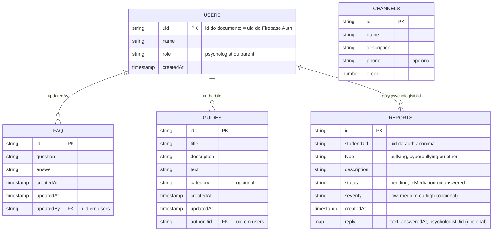

# Modelagem do Banco de Dados (Firebase)

O app usa dois armazenamentos. O Firestore guarda conteúdo da escola e denúncias. O aparelho guarda o diário do aluno, e esses dados nunca vão para a nuvem.


Código-fonte do diagrama:



Todos os nomes de coleções e de campos do Firestore ficam em inglês, como já fazem `users` e `faq` no código. Só o texto exibido na tela é em português.

## Estrutura de coleções

```
users/{uid}          perfil de psicóloga e responsável (criado pela escola, fora do app)
faq/{faqId}          perguntas e respostas (leitura pública)
guides/{guideId}     guias para responsáveis
channels/{channelId} canais de apoio externos (cadastro pelo console)
reports/{reportId}   relatos anônimos, com a resposta da psicóloga dentro do documento
```

Obs: A resposta é um campo do tipo map dentro do relato, porque cada relato tem no máximo uma resposta.

## Campos

**users/{uid}**

| Campo | Tipo | Observação |
|---|---|---|
| name | string | Exibido no painel ("Olá, Camila!") |
| role | string | `psychologist` ou `parent` |
| createdAt | timestamp | |

O id do documento é o `uid` do Firebase Auth. Aluno anônimo não tem documento aqui.

**faq/{faqId}**

| Campo | Tipo | Observação |
|---|---|---|
| question | string | Título exibido no ExpansionTile |
| answer | string | Conteúdo expandido |
| createdAt, updatedAt | timestamp | |
| updatedBy | string | `uid` da psicóloga |

**guides/{guideId}**

| Campo | Tipo | Observação |
|---|---|---|
| title, description, text | string | Os três campos do formulário de publicação |
| category | string, opcional | Etiqueta do cartão (por exemplo, saúde mental juvenil) |
| createdAt, updatedAt | timestamp | |
| authorUid | string | `uid` da psicóloga |

**channels/{channelId}**

| Campo | Tipo | Observação |
|---|---|---|
| name, description | string | |
| phone | string, opcional | Quando existe, o botão disca |
| order | number | Ordem de exibição |

**reports/{reportId}**

| Campo | Tipo | Observação |
|---|---|---|
| studentUid | string | `uid` da autenticação anônima. O painel de triagem nunca lê este campo |
| type | string | `bullying`, `cyberbullying` ou `other` |
| description | string | Texto livre do aluno |
| status | string | `pending` ao criar, `inMediation` enquanto a equipe acompanha o relato e `answered` depois da resposta |
| severity | string, opcional | `low`, `medium` ou `high`. O aluno não envia: o painel de triagem estima pelo tipo e pelo texto quando o campo falta |
| createdAt | timestamp | Gravado com o horário do servidor |
| reply | map, opcional | `text`, `answeredAt`, `psychologistUid` |

## Índices compostos

| Consulta | Índice |
|---|---|
| Painel de triagem (RF09): todos os relatos, do mais recente para o mais antigo | `createdAt` decrescente (índice simples, automático). Os filtros de gravidade e de status são aplicados no app |
| Triagem da psicóloga: relatos pendentes do mais antigo para o mais novo | `status` crescente, `createdAt` crescente |
| Lista do aluno: os próprios relatos, do mais recente para o mais antigo | `studentUid` crescente, `createdAt` decrescente |


## Regras de segurança

```
rules_version = '2';
service cloud.firestore {
  match /databases/{database}/documents {

    function signedIn() {
      return request.auth != null;
    }
    function roleOf(uid) {
      return get(/databases/$(database)/documents/users/$(uid)).data.role;
    }
    function isPsychologist() {
      return signedIn()
        && exists(/databases/$(database)/documents/users/$(request.auth.uid))
        && roleOf(request.auth.uid) == 'psychologist';
    }
    function isParent() {
      return signedIn()
        && exists(/databases/$(database)/documents/users/$(request.auth.uid))
        && roleOf(request.auth.uid) == 'parent';
    }

    match /users/{uid} {
      allow get: if signedIn() && request.auth.uid == uid;
      allow list, write: if false;
    }

    match /faq/{id} {
      allow read: if true;
      allow write: if isPsychologist();
    }

    match /channels/{id} {
      allow read: if true;
      allow write: if false;
    }

    match /guides/{id} {
      allow read: if isPsychologist() || isParent();
      allow write: if isPsychologist();
    }

    match /reports/{id} {
      allow create: if signedIn()
        && request.resource.data.keys().hasOnly(['studentUid', 'type', 'description', 'status', 'createdAt'])
        && request.resource.data.studentUid == request.auth.uid
        && request.resource.data.status == 'pending'
        && request.resource.data.type in ['bullying', 'cyberbullying', 'other']
        && request.resource.data.description is string
        && request.resource.data.description.size() > 0
        && request.resource.data.description.size() <= 2000
        && request.resource.data.createdAt == request.time;

      allow read: if signedIn()
        && (resource.data.studentUid == request.auth.uid || isPsychologist());

      allow update: if isPsychologist()
        && request.resource.data.diff(resource.data).affectedKeys().hasOnly(['status', 'severity', 'reply'])
        && request.resource.data.status in ['pending', 'inMediation', 'answered'];

      allow delete: if false;
    }
  }
}
```

A descrição do relato tem limite de 2000 caracteres.

O painel de triagem (RF09) só lê a coleção `reports` e nunca usa o `studentUid`. A regra de `update` acima já aceita `inMediation` e a chave `severity`, que a resposta da psicóloga (RF10) vai gravar. O repositório não versiona o arquivo `firestore.rules`, então a regra precisa ser publicada no console do Firebase.

## Comportamento sem internet

- Leituras do FAQ, dos canais e dos guias usam o cache do Firestore depois da primeira carga.
- A denúncia criada sem internet entra na fila do Firestore e é enviada quando a conexão volta. Enquanto isso, a tela mostra o estado "aguardando envio".
- Respostas da psicóloga só aparecem para o aluno depois que ele abrir o app com internet.

## O que fica fora do Firestore

O diário do aluno (humor, texto, pontos positivos e histórico) e o codinome ficam no aparelho, em caixa criptografada. A decisão vem do aditivo e do RNF03. O mapeamento dessas classes está em `04-mapeamento-dart-firestore.md`.

O gatilho de apoio por sofrimento intenso (UC20, RN11) também não usa o Firestore: ele lê o diário no aparelho e guarda só o próprio estado de controle (`EstadoGatilhoApoio`) localmente. Não há coleção nova, nem mudança em `firestore.rules`, nem leitura ou escrita no Firestore, e a escola não fica sabendo que o modal apareceu.

## Observações

- O papel do usuário é lido do documento em `users`.
- A autenticação anônima gera um identificador que o Firebase associa ao aparelho. O projeto não usa Firebase Analytics nem Crashlytics.
- Se o aluno desinstalar o app, perde o acesso às respostas, porque o identificador anônimo é descartado.
