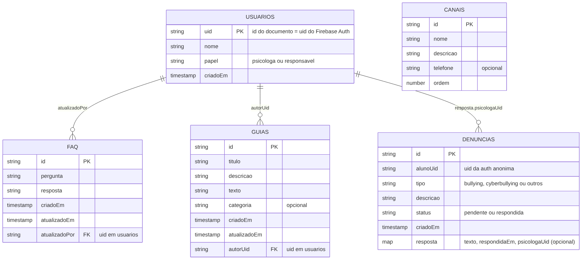
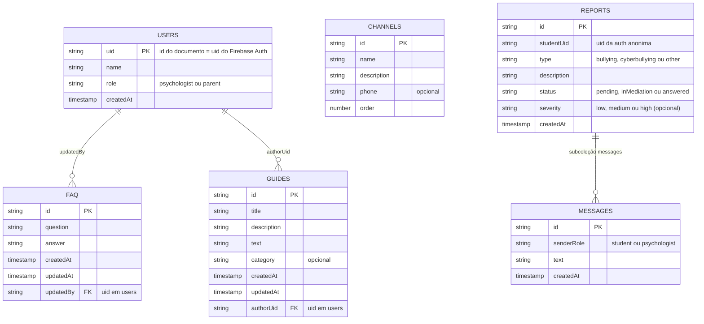

# Modelagem do Banco de Dados (Firebase)

O app usa dois armazenamentos. O Firestore guarda conteúdo da escola e denúncias. O aparelho guarda o diário do aluno, e esses dados nunca vão para a nuvem.



Código-fonte do diagrama:



Todos os nomes de coleções e de campos do Firestore ficam em inglês, como já fazem `users` e `faq` no código. Só o texto exibido na tela é em português.

## Estrutura de coleções

```
users/{uid}          perfil de psicóloga e responsável (criado pela escola, fora do app)
faq/{faqId}          perguntas e respostas (leitura pública)
guides/{guideId}     guias para responsáveis
channels/{channelId} canais de apoio externos (cadastro pelo console)
reports/{studentUid} relato anônimo do aluno; o id é o uid da autenticação anônima
reports/{studentUid}/messages/{messageId}   mensagens do chat entre o aluno e a psicóloga
```

Obs: Cada aluno tem uma única conversa, no documento `reports/{uid}`. A primeira mensagem cria o relato e as seguintes entram na subcoleção `messages`, que o app acompanha em tempo real. O id do relato ser o `uid` evita consulta e índice para achar a conversa do aluno.

## Campos

**users/{uid}**

| Campo | Tipo | Observação |
|---|---|---|
| name | string | Exibido no painel ("Olá, Camila!") |
| role | string | `psychologist` ou `parent` |
| createdAt | timestamp | |

O id do documento é o `uid` do Firebase Auth. Aluno anônimo não tem documento aqui.

**faq/{faqId}**

| Campo | Tipo | Observação |
|---|---|---|
| question | string | Título exibido no ExpansionTile |
| answer | string | Conteúdo expandido |
| createdAt, updatedAt | timestamp | |
| updatedBy | string | `uid` da psicóloga |

**guides/{guideId}**

| Campo | Tipo | Observação |
|---|---|---|
| title, description, text | string | Os três campos do formulário de publicação |
| category | string, opcional | Etiqueta do cartão (por exemplo, saúde mental juvenil) |
| createdAt, updatedAt | timestamp | |
| authorUid | string | `uid` da psicóloga |

**channels/{channelId}**

| Campo | Tipo | Observação |
|---|---|---|
| name, description | string | |
| phone | string, opcional | Quando existe, o botão disca |
| order | number | Ordem de exibição |

**reports/{reportId}**

| Campo | Tipo | Observação |
|---|---|---|
| studentUid | string | `uid` da autenticação anônima. O painel de triagem nunca lê este campo |
| type | string | `bullying`, `cyberbullying` ou `other` |
| description | string | Texto livre do aluno |
| status | string | `pending` ao criar, `inMediation` enquanto a equipe acompanha o relato e `answered` depois da resposta |
| severity | string, opcional | `low`, `medium` ou `high`. O aluno não envia: o painel de triagem estima pelo tipo e pelo texto quando o campo falta |
| createdAt | timestamp | Gravado com o horário do servidor |

O id do documento é o `studentUid`. `description` guarda a primeira mensagem da conversa, que é o que o painel de triagem mostra. Quando o aluno escreve de novo num relato `answered`, o app devolve o `status` para `pending`.

**reports/{studentUid}/messages/{messageId}**

| Campo | Tipo | Observação |
|---|---|---|
| senderRole | string | `student` ou `psychologist` |
| text | string | De 1 a 2000 caracteres |
| createdAt | timestamp | Gravado com o horário do servidor |

A mensagem não guarda nome nem nenhum dado do aluno. O app lê a subcoleção com `orderBy('createdAt')` e `snapshots(includeMetadataChanges: true)`, e usa `metadata.hasPendingWrites` para mostrar "Enviando…".

## Índices compostos

| Consulta | Índice |
|---|---|
| Painel de triagem (RF09): todos os relatos, do mais recente para o mais antigo | `createdAt` decrescente (índice simples, automático). A ordem de triagem (gravidade e antiguidade) é aplicada no app |
| Triagem da psicóloga: relatos pendentes do mais antigo para o mais novo | `status` crescente, `createdAt` crescente |
| Chat do aluno: mensagens da conversa em ordem de envio | `createdAt` crescente (índice simples, automático) |


## Regras de segurança

```
rules_version = '2';
service cloud.firestore {
  match /databases/{database}/documents {

    function signedIn() {
      return request.auth != null;
    }
    function roleOf(uid) {
      return get(/databases/$(database)/documents/users/$(uid)).data.role;
    }
    function isPsychologist() {
      return signedIn()
        && exists(/databases/$(database)/documents/users/$(request.auth.uid))
        && roleOf(request.auth.uid) == 'psychologist';
    }
    function isParent() {
      return signedIn()
        && exists(/databases/$(database)/documents/users/$(request.auth.uid))
        && roleOf(request.auth.uid) == 'parent';
    }

    match /users/{uid} {
      allow get: if signedIn() && request.auth.uid == uid;
      allow list, write: if false;
    }

    match /faq/{id} {
      allow read: if true;
      allow write: if isPsychologist();
    }

    match /channels/{id} {
      allow read: if true;
      allow write: if false;
    }

    match /guides/{id} {
      allow read: if isPsychologist() || isParent();
      allow write: if isPsychologist();
    }

    match /reports/{id} {
      allow create: if signedIn()
        && id == request.auth.uid
        && request.resource.data.keys().hasOnly(['studentUid', 'type', 'description', 'status', 'createdAt'])
        && request.resource.data.studentUid == request.auth.uid
        && request.resource.data.status == 'pending'
        && request.resource.data.type in ['bullying', 'cyberbullying', 'other']
        && request.resource.data.description is string
        && request.resource.data.description.size() > 0
        && request.resource.data.description.size() <= 2000
        && request.resource.data.createdAt == request.time;

      // resource == null permite ao aluno acompanhar a própria conversa
      // antes de enviar a primeira mensagem.
      allow read: if signedIn()
        && ((resource == null && id == request.auth.uid)
          || (resource != null && (resource.data.studentUid == request.auth.uid || isPsychologist())));

      allow update: if (
          isPsychologist()
          && request.resource.data.diff(resource.data).affectedKeys().hasOnly(['status', 'severity'])
          && request.resource.data.status in ['pending', 'inMediation', 'answered']
        ) || (
          signedIn()
          && resource.data.studentUid == request.auth.uid
          && request.resource.data.diff(resource.data).affectedKeys().hasOnly(['status'])
          && request.resource.data.status == 'pending'
        );

      allow delete: if false;

      match /messages/{messageId} {
        allow read: if signedIn() && (id == request.auth.uid || isPsychologist());

        allow create: if signedIn()
          && request.resource.data.keys().hasOnly(['senderRole', 'text', 'createdAt'])
          && request.resource.data.text is string
          && request.resource.data.text.size() > 0
          && request.resource.data.text.size() <= 2000
          && request.resource.data.createdAt == request.time
          && ((request.resource.data.senderRole == 'student' && id == request.auth.uid)
            || (request.resource.data.senderRole == 'psychologist' && isPsychologist()));

        allow update, delete: if false;
      }
    }
  }
}
```

A descrição do relato tem limite de 2000 caracteres.

O painel de triagem (RF09) só lê a coleção `reports` e nunca usa o `studentUid`. Na regra de `update`, a psicóloga pode mudar `status` e `severity` (o app só grava `status`, ao responder) e o aluno só pode devolver o relato para `pending` ao escrever de novo. Nenhuma tela do app grava `inMediation` ou `severity`: são valores que a equipe pode definir pelo console. A regra de `create` das mensagens aceita `psychologist` para a resposta da psicóloga (RF10). O repositório não versiona o arquivo `firestore.rules`, então as regras precisam ser publicadas no console do Firebase.

## Comportamento sem internet

- Leituras do FAQ, dos canais e dos guias usam o cache do Firestore depois da primeira carga.
- A mensagem escrita sem internet entra na fila do Firestore e é enviada quando a conexão volta. Enquanto isso, o balão mostra "Enviando…".
- Com internet, o chat funciona em tempo real: a resposta da psicóloga aparece na tela do aluno assim que é gravada, sem recarregar, e a mensagem do aluno aparece na tela da psicóloga do mesmo jeito. O painel de triagem também acompanha `reports` em tempo real.
- A resposta da psicóloga grava a mensagem (`senderRole: psychologist`) e, no mesmo lote, muda o `status` do relato para `answered` se ele estava `pending`.
- Sem internet e sem cache, o aluno não vê respostas novas, que chegam quando a conexão volta.
- O aluno que entrou só com a sessão local (sem login anônimo no Firebase) não consegue enviar; o chat avisa para conectar à internet.

## O que fica fora do Firestore

O diário do aluno (humor, texto, pontos positivos e histórico) e o codinome ficam no aparelho, em caixa criptografada. A decisão vem do aditivo e do RNF03. O mapeamento dessas classes está em `04-mapeamento-dart-firestore.md`.

O gatilho de apoio por sofrimento intenso (UC20, RN11) também não usa o Firestore: ele lê o diário no aparelho e guarda só o próprio estado de controle (`EstadoGatilhoApoio`) localmente. Não há coleção nova, nem mudança em `firestore.rules`, nem leitura ou escrita no Firestore, e a escola não fica sabendo que o modal apareceu.

## Observações

- O papel do usuário é lido do documento em `users`.
- A autenticação anônima gera um identificador que o Firebase associa ao aparelho. O projeto não usa Firebase Analytics nem Crashlytics.
- Se o aluno desinstalar o app, perde o acesso às respostas, porque o identificador anônimo é descartado.
