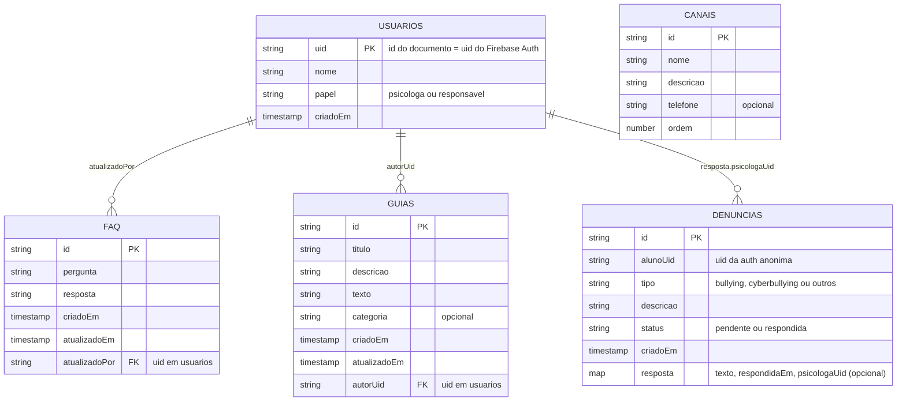

# Modelagem do Banco de Dados (Firebase)

O app usa dois armazenamentos. O Firestore guarda conteúdo da escola e denúncias. O aparelho guarda o diário do aluno, e esses dados nunca vão para a nuvem.


Código-fonte do diagrama:



## Estrutura de coleções

```
usuarios/{uid}          perfil de psicóloga e responsável (criado pela escola, fora do app)
faq/{faqId}             perguntas e respostas (leitura pública)
guias/{guiaId}          guias para responsáveis
canais/{canalId}        canais de apoio externos (cadastro pelo console)
denuncias/{denunciaId}  relatos anônimos, com a resposta da psicóloga dentro do documento
```

Obs: A resposta é um campo do tipo map dentro da denúncia, porque cada denúncia tem no máximo uma resposta.

## Campos

**usuarios/{uid}**

| Campo | Tipo | Observação |
|---|---|---|
| nome | string | Exibido no painel ("Olá, Camila!") |
| papel | string | `psicologa` ou `responsavel` |
| criadoEm | timestamp | |

O id do documento é o `uid` do Firebase Auth. Aluno anônimo não tem documento aqui.

**faq/{faqId}**

| Campo | Tipo | Observação |
|---|---|---|
| pergunta | string | Título exibido no ExpansionTile |
| resposta | string | Conteúdo expandido |
| criadoEm, atualizadoEm | timestamp | |
| atualizadoPor | string | `uid` da psicóloga |

**guias/{guiaId}**

| Campo | Tipo | Observação |
|---|---|---|
| titulo, descricao, texto | string | Os três campos do formulário de publicação |
| categoria | string, opcional | Etiqueta do cartão (por exemplo, saúde mental juvenil) |
| criadoEm, atualizadoEm | timestamp | |
| autorUid | string | `uid` da psicóloga |

**canais/{canalId}**

| Campo | Tipo | Observação |
|---|---|---|
| nome, descricao | string | |
| telefone | string, opcional | Quando existe, o botão disca |
| ordem | number | Ordem de exibição |

**denuncias/{denunciaId}**

| Campo | Tipo | Observação |
|---|---|---|
| alunoUid | string | `uid` da autenticação anônima |
| tipo | string | `bullying`, `cyberbullying` ou `outros` |
| descricao | string | Texto livre do aluno |
| status | string | `pendente` ao criar, `respondida` depois da resposta |
| criadoEm | timestamp | Gravado com o horário do servidor |
| resposta | map, opcional | `texto`, `respondidaEm`, `psicologaUid` |

## Índices compostos

| Consulta | Índice |
|---|---|
| Triagem da psicóloga: denúncias pendentes da mais antiga para a mais nova | `status` crescente, `criadoEm` crescente |
| Lista do aluno: as próprias denúncias, da mais recente para a mais antiga | `alunoUid` crescente, `criadoEm` decrescente |


## Regras de segurança

```
rules_version = '2';
service cloud.firestore {
  match /databases/{database}/documents {

    function logado() {
      return request.auth != null;
    }
    function papelDe(uid) {
      return get(/databases/$(database)/documents/usuarios/$(uid)).data.papel;
    }
    function ehPsicologa() {
      return logado()
        && exists(/databases/$(database)/documents/usuarios/$(request.auth.uid))
        && papelDe(request.auth.uid) == 'psicologa';
    }
    function ehResponsavel() {
      return logado()
        && exists(/databases/$(database)/documents/usuarios/$(request.auth.uid))
        && papelDe(request.auth.uid) == 'responsavel';
    }

    match /usuarios/{uid} {
      allow get: if logado() && request.auth.uid == uid;
      allow list, write: if false;
    }

    match /faq/{id} {
      allow read: if true;
      allow write: if ehPsicologa();
    }

    match /canais/{id} {
      allow read: if true;
      allow write: if false;
    }

    match /guias/{id} {
      allow read: if ehPsicologa() || ehResponsavel();
      allow write: if ehPsicologa();
    }

    match /denuncias/{id} {
      allow create: if logado()
        && request.resource.data.keys().hasOnly(['alunoUid', 'tipo', 'descricao', 'status', 'criadoEm'])
        && request.resource.data.alunoUid == request.auth.uid
        && request.resource.data.status == 'pendente'
        && request.resource.data.tipo in ['bullying', 'cyberbullying', 'outros']
        && request.resource.data.descricao is string
        && request.resource.data.descricao.size() > 0
        && request.resource.data.descricao.size() <= 2000
        && request.resource.data.criadoEm == request.time;

      allow read: if logado()
        && (resource.data.alunoUid == request.auth.uid || ehPsicologa());

      allow update: if ehPsicologa()
        && request.resource.data.diff(resource.data).affectedKeys().hasOnly(['status', 'resposta'])
        && request.resource.data.status in ['pendente', 'respondida'];

      allow delete: if false;
    }
  }
}
```

A descrição da denúncia tem limite de 2000 caracteres.

## Comportamento sem internet

- Leituras do FAQ, dos canais e dos guias usam o cache do Firestore depois da primeira carga.
- A denúncia criada sem internet entra na fila do Firestore e é enviada quando a conexão volta. Enquanto isso, a tela mostra o estado "aguardando envio".
- Respostas da psicóloga só aparecem para o aluno depois que ele abrir o app com internet.

## O que fica fora do Firestore

O diário do aluno (humor, texto, pontos positivos e histórico) e o codinome ficam no aparelho, em caixa criptografada. A decisão vem do aditivo e do RNF03. O mapeamento dessas classes está em `04-mapeamento-dart-firestore.md`.

## Observações

- O papel do usuário é lido do documento em `usuarios`.
- A autenticação anônima gera um identificador que o Firebase associa ao aparelho. O projeto não usa Firebase Analytics nem Crashlytics.
- Se o aluno desinstalar o app, perde o acesso às respostas, porque o identificador anônimo é descartado.
