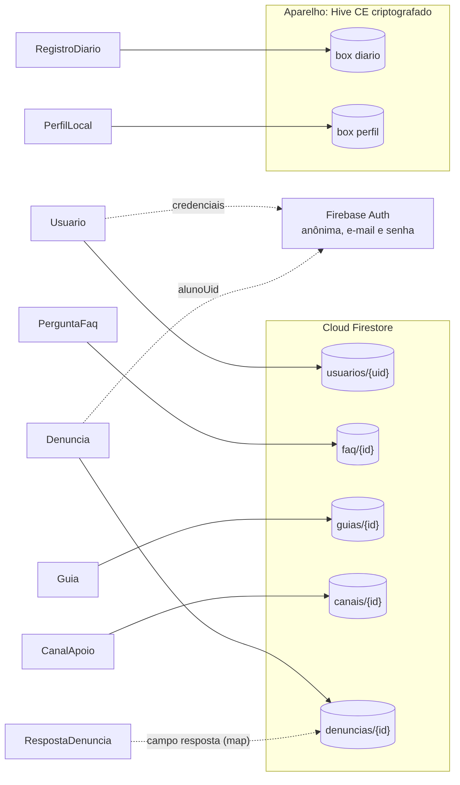
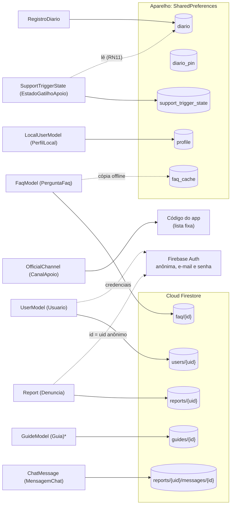

# Mapeamento das classes Dart para o Firebase e o aparelho

Mostra para onde cada classe de domínio vai e como os campos são convertidos. Os nomes de classes e de campos gravados estão em inglês, como no código. O nome em português, usado no diagrama de classes (`02`), aparece entre parênteses.





\* `GuideModel` está na branch `feat/parents-home-e-guias-psicologa`, ainda não mesclada na `main`.

> A imagem `mapeamento-dart-firestore.png` está desatualizada: ainda mostra as coleções `usuarios`, `denuncias`, `guias` e `canais` e o campo `resposta`. O código-fonte Mermaid acima é a versão atual.

## Tabela de mapeamento

| Classe Dart | Destino | Caminho | Conversão |
|---|---|---|---|
| `UserModel` | Firestore e Firebase Auth | `users/{uid}` | `uid` é o id do documento. `role` é lido com `Role.values.byName`. Só leitura: o documento é criado pela escola. As credenciais ficam no Auth. |
| `FaqModel` | Firestore e aparelho | `faq/{id}` e chave `faq_cache` | `id` é o id do documento. No Firestore as datas viram `Timestamp` e `updatedAt` usa `FieldValue.serverTimestamp()`. No cache local, as datas viram texto ISO 8601. |
| `GuideModel` | Firestore | `guides/{id}` | Igual ao FAQ. `category` e `authorUid` são omitidos quando vazios. |
| `Report` | Firestore | `reports/{uid}` | O id do documento é o `uid` anônimo do aluno. `type`, `status` e `severity` são gravados pelo nome do enum. `createdAt` usa `FieldValue.serverTimestamp()`. O `studentUid` é gravado, mas nunca lido pelo app. |
| `ChatMessage` | Firestore | `reports/{uid}/messages/{id}` | `senderRole` é `student` ou `psychologist`. `createdAt` usa `FieldValue.serverTimestamp()`. `isPending` não é gravado: vem de `metadata.hasPendingWrites`. |
| `OfficialChannel` | Código do app | `officialChannels` | Lista constante. Não é gravada em lugar nenhum. |
| `RegistroDiario` | Aparelho | SharedPreferences, chave `diario` | JSON `{id: registro}`; cada registro vem do `toMap`: `humor` pelo nome do enum, `dataHora` em texto ISO 8601. |
| PIN do diário | Aparelho | SharedPreferences, chave `diario_pin` | Hash SHA-256 com salt (`DiaryLockRepository`). O PIN em si nunca é gravado. |
| `LocalUserModel` | Aparelho | SharedPreferences, chave `profile` | JSON com codinome e avatar (`ProfileStore`). |
| `SupportTriggerState` | Aparelho | SharedPreferences, chave `support_trigger_state` | JSON `{lastShownAt, countFrom}`, datas em texto ISO 8601, gravado pelo `SupportTriggerStateStore`. Se a chave estiver corrompida, é lida como estado vazio. Nunca vai para o Firestore. |

Os enums são gravados pelo nome (`Humor.comRaiva` vira `"comRaiva"`). `Report` e `ChatMessage` leem com `fromName`, que troca um valor desconhecido por um padrão seguro (status desconhecido volta para `pending`, remetente desconhecido nunca é tratado como o aluno). `UserModel` usa `values.byName`, que lança erro.

## Exemplo: relato e chat no Firestore

A primeira mensagem do aluno cria o relato e a mensagem no mesmo lote (`ChatRepository.send`):

```dart
final batch = _firestore.batch();
batch.set(report.collection('messages').doc(), {
  'senderRole': ChatSender.student.name,
  'text': text,
  'createdAt': FieldValue.serverTimestamp(),
});
if (_status == null) {
  // Primeira mensagem: cria o relato que a psicóloga vê na triagem.
  batch.set(report, {
    'studentUid': report.id,
    'type': type.name,
    'description': text,
    'status': ReportStatus.pending.name,
    'createdAt': FieldValue.serverTimestamp(),
  });
} else if (_status == ReportStatus.answered) {
  // O aluno voltou a escrever: o relato volta para a fila da triagem.
  batch.update(report, {'status': ReportStatus.pending.name});
}
// Sem internet, o commit fica na fila local do Firestore.
await batch.commit().timeout(queueTimeout);
```

A resposta da psicóloga (`PsychologistChatRepository`) grava uma mensagem com `senderRole: psychologist` e, no mesmo lote, muda o `status` do relato para `answered` se ele estava `pending`.

Leitura do relato no painel de triagem (`Report.fromMap`). Campo ausente ou inválido usa um valor seguro, para um documento malformado não derrubar a triagem:

```dart
factory Report.fromMap(String id, Map<String, dynamic> data) {
  final type = ReportType.fromName(data['type'] as String?);
  final description = (data['description'] as String?) ?? '';
  final rawCreatedAt = data['createdAt'];
  return Report(
    id: id,
    type: type,
    description: description,
    status: ReportStatus.fromName(data['status'] as String?),
    // Enquanto o servidor não confirma o horário, o campo vem nulo.
    createdAt: rawCreatedAt is Timestamp ? rawCreatedAt.toDate() : DateTime.now(),
    severity: ReportSeverity.tryFromName(data['severity'] as String?) ??
        ReportSeverity.infer(type, description),
  );
}
```

Para o balão mostrar "Enviando…" e atualizar quando a mensagem sincronizar, a consulta das mensagens usa `orderBy('createdAt')` e `snapshots(includeMetadataChanges: true)`, e passa `doc.metadata.hasPendingWrites` para `ChatMessage.fromMap`.

## Exemplo: FaqModel e busca

```dart
factory FaqModel.fromFirestore(
  DocumentSnapshot<Map<String, dynamic>> snapshot,
  SnapshotOptions? options,
) {
  final data = snapshot.data();
  if (data == null) {
    throw StateError('Documento de FAQ vazio ou inexistente: ${snapshot.id}');
  }
  return FaqModel(
    id: snapshot.id,
    question: (data['question'] as String?) ?? '',
    answer: (data['answer'] as String?) ?? '',
    createdAt: (data['createdAt'] as Timestamp?)?.toDate() ?? DateTime.now(),
    updatedAt: (data['updatedAt'] as Timestamp?)?.toDate() ?? DateTime.now(),
    updatedBy: (data['updatedBy'] as String?) ?? '',
  );
}

Map<String, dynamic> toFirestore() => {
  'question': question,
  'answer': answer,
  'createdAt': Timestamp.fromDate(createdAt),
  'updatedAt': FieldValue.serverTimestamp(),
  'updatedBy': updatedBy,
};
```

A busca (`FaqModel.matches`) roda no aparelho, sobre a lista já carregada, porque o Firestore não faz busca de texto e o FAQ é pequeno.

## Exemplo: RegistroDiario no aparelho

O diário vai para o `SharedPreferences`, na chave `diario`, como um JSON `{id: registro}` (`PrefsDiaryRepository`). É o mesmo pacote que já guarda o perfil do aluno, então não há dependência nova. Os dados ficam só no aparelho, mas sem criptografia. O que protege o diário é o PIN, guardado só como hash.

```dart
enum Humor { feliz, neutro, triste, ansioso, comRaiva, cansado }

class RegistroDiario {
  final String id;
  final Humor humor;
  final String? texto;
  final List<String> pontosPositivos;
  final DateTime dataHora;

  const RegistroDiario({
    required this.id,
    required this.humor,
    this.texto,
    this.pontosPositivos = const [],
    required this.dataHora,
  });

  Map<String, dynamic> toMap() => {
        'id': id,
        'humor': humor.name,
        'texto': texto,
        'pontosPositivos': pontosPositivos,
        'dataHora': dataHora.toIso8601String(),
      };

  factory RegistroDiario.fromMap(Map m) => RegistroDiario(
        id: m['id'] as String,
        humor: Humor.values.byName(m['humor'] as String),
        texto: m['texto'] as String?,
        pontosPositivos: List<String>.from(m['pontosPositivos'] as List),
        dataHora: DateTime.parse(m['dataHora'] as String),
      );
}
```

`UserModel` e `GuideModel` seguem o mesmo padrão de `fromFirestore` mostrado no FAQ.
