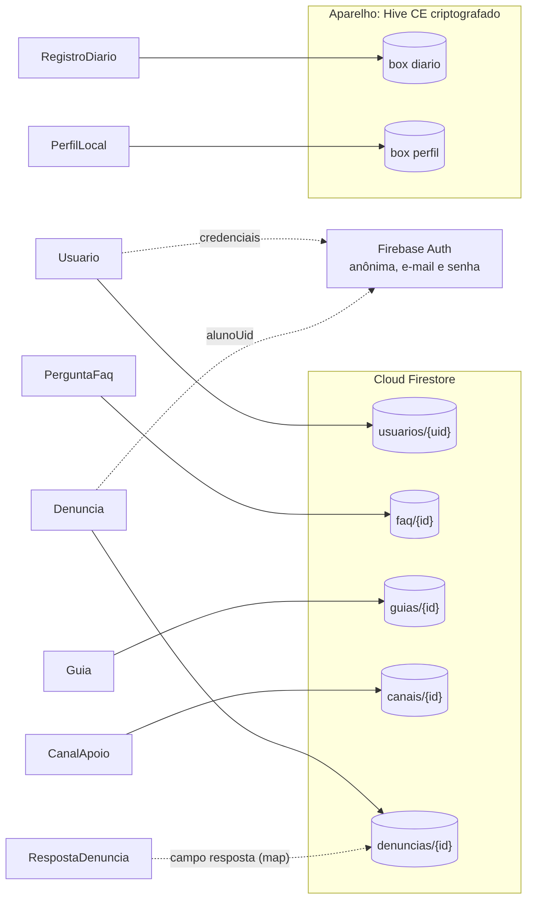
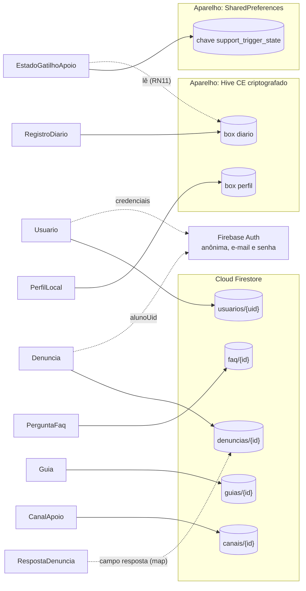

# Mapeamento das classes Dart para o Firebase e o aparelho

Mostra para onde cada classe de domínio vai e como os campos são convertidos.





> A imagem `mapeamento-dart-firestore.png` ainda não mostra `EstadoGatilhoApoio`. O código-fonte Mermaid acima é a versão atual.

## Tabela de mapeamento

| Classe Dart | Destino | Caminho | Conversão |
|---|---|---|---|
| Usuario | Firestore e Firebase Auth | `usuarios/{uid}` | `uid` é o id do documento. `papel` vira texto (`Papel.name`). As credenciais ficam no Auth, não no documento. |
| PerguntaFaq | Firestore | `faq/{id}` | `id` é o id do documento. As datas viram `Timestamp`. |
| Guia | Firestore | `guias/{id}` | Igual ao FAQ. `categoria` é omitida quando nula. |
| CanalApoio | Firestore | `canais/{id}` | `telefone` é omitido quando nulo. `podeDiscar` é calculado (`telefone != null`) e não é gravado. |
| Denuncia | Firestore | `denuncias/{id}` | `tipo` e `status` viram texto. `criadoEm` usa `FieldValue.serverTimestamp()`. `aguardandoEnvio` não é gravado: vem de `metadata.hasPendingWrites`. |
| RespostaDenuncia | Firestore | campo `resposta` (map) em `denuncias/{id}` | Vira `{texto, respondidaEm, psicologaUid}`. Ausente enquanto a denúncia está pendente. |
| RegistroDiario | Aparelho | Hive, caixa `diario` (criptografada) | Gravado como `Map`: `humor` pelo nome do enum, `dataHora` em texto ISO 8601. |
| PerfilLocal | Aparelho | Hive, caixa `perfil` | Gravado como `Map` com o `codinome`. |
| EstadoGatilhoApoio (`SupportTriggerState`) | Aparelho | SharedPreferences, chave `support_trigger_state` | JSON `{lastShownAt, countFrom}`, datas em texto ISO 8601, gravado pelo `SupportTriggerStateStore`. Se a chave estiver corrompida, é lida como estado vazio. Fica no mesmo armazenamento do diário: se o diário passar a ser criptografado, esta chave também deve ser. Nunca vai para o Firestore. |

Os enums são gravados pelo nome (`Humor.comRaiva` vira `"comRaiva"`) e lidos com `values.byName`.

## Exemplo: Denuncia no Firestore

Conversão entre o objeto Dart e o documento do Firestore.

```dart
import 'package:cloud_firestore/cloud_firestore.dart';

enum TipoRelato { bullying, cyberbullying, outros }
enum StatusDenuncia { pendente, respondida }

class RespostaDenuncia {
  final String texto;
  final DateTime respondidaEm;
  final String psicologaUid;

  const RespostaDenuncia({
    required this.texto,
    required this.respondidaEm,
    required this.psicologaUid,
  });

  factory RespostaDenuncia.fromMap(Map<String, dynamic> m) => RespostaDenuncia(
        texto: m['texto'] as String,
        respondidaEm: (m['respondidaEm'] as Timestamp?)?.toDate() ?? DateTime.now(),
        psicologaUid: m['psicologaUid'] as String,
      );
}

class Denuncia {
  final String id;
  final String alunoUid;
  final TipoRelato tipo;
  final String descricao;
  final StatusDenuncia status;
  final DateTime criadoEm;
  final RespostaDenuncia? resposta;
  final bool aguardandoEnvio; // não vai para o Firestore

  const Denuncia({
    required this.id,
    required this.alunoUid,
    required this.tipo,
    required this.descricao,
    required this.status,
    required this.criadoEm,
    this.resposta,
    this.aguardandoEnvio = false,
  });

  bool get estaPendente => status == StatusDenuncia.pendente;

  // Leitura: documento do Firestore para objeto Dart
  factory Denuncia.fromFirestore(
    DocumentSnapshot<Map<String, dynamic>> snap,
    SnapshotOptions? options,
  ) {
    final d = snap.data()!;
    final resposta = d['resposta'];
    return Denuncia(
      id: snap.id,
      alunoUid: d['alunoUid'] as String,
      tipo: TipoRelato.values.byName(d['tipo'] as String),
      descricao: d['descricao'] as String,
      status: StatusDenuncia.values.byName(d['status'] as String),
      // enquanto o servidor não confirma, o campo pode vir nulo
      criadoEm: (d['criadoEm'] as Timestamp?)?.toDate() ?? DateTime.now(),
      resposta: resposta == null
          ? null
          : RespostaDenuncia.fromMap(Map<String, dynamic>.from(resposta as Map)),
      aguardandoEnvio: snap.metadata.hasPendingWrites,
    );
  }

  // Criação: objeto Dart para documento (só os campos que as regras aceitam)
  Map<String, dynamic> toFirestoreCriacao() => {
        'alunoUid': alunoUid,
        'tipo': tipo.name,
        'descricao': descricao,
        'status': StatusDenuncia.pendente.name,
        'criadoEm': FieldValue.serverTimestamp(),
      };
}

// Referência tipada da coleção
final denuncias = FirebaseFirestore.instance
    .collection('denuncias')
    .withConverter<Denuncia>(
      fromFirestore: Denuncia.fromFirestore,
      toFirestore: (d, _) => d.toFirestoreCriacao(),
    );

// Resposta da psicóloga (atualiza só status e resposta, como as regras exigem)
Future<void> responder(String denunciaId, String texto, String psicologaUid) {
  return FirebaseFirestore.instance.collection('denuncias').doc(denunciaId).update({
    'status': StatusDenuncia.respondida.name,
    'resposta': {
      'texto': texto,
      'respondidaEm': FieldValue.serverTimestamp(),
      'psicologaUid': psicologaUid,
    },
  });
}
```

Para o estado "aguardando envio" atualizar na tela quando a denúncia sincronizar, a consulta precisa de `snapshots(includeMetadataChanges: true)`.

## Exemplo: PerguntaFaq e busca

```dart
class PerguntaFaq {
  final String id;
  final String pergunta;
  final String resposta;
  final DateTime criadoEm;
  final DateTime atualizadoEm;
  final String atualizadoPor;

  const PerguntaFaq({
    required this.id,
    required this.pergunta,
    required this.resposta,
    required this.criadoEm,
    required this.atualizadoEm,
    required this.atualizadoPor,
  });

  bool corresponde(String termo) {
    final t = termo.trim().toLowerCase();
    return t.isEmpty ||
        pergunta.toLowerCase().contains(t) ||
        resposta.toLowerCase().contains(t);
  }

  factory PerguntaFaq.fromFirestore(
    DocumentSnapshot<Map<String, dynamic>> snap,
    SnapshotOptions? options,
  ) {
    final d = snap.data()!;
    return PerguntaFaq(
      id: snap.id,
      pergunta: d['pergunta'] as String,
      resposta: d['resposta'] as String,
      criadoEm: (d['criadoEm'] as Timestamp?)?.toDate() ?? DateTime.now(),
      atualizadoEm: (d['atualizadoEm'] as Timestamp?)?.toDate() ?? DateTime.now(),
      atualizadoPor: d['atualizadoPor'] as String,
    );
  }

  Map<String, dynamic> toFirestore() => {
        'pergunta': pergunta,
        'resposta': resposta,
        'criadoEm': Timestamp.fromDate(criadoEm),
        'atualizadoEm': FieldValue.serverTimestamp(),
        'atualizadoPor': atualizadoPor,
      };
}
```

A busca roda no aparelho, sobre a lista já carregada, porque o Firestore não faz busca de texto e o FAQ é pequeno.

## Exemplo: RegistroDiario no aparelho

O diário vai para uma caixa do Hive criptografada, e a chave fica no `flutter_secure_storage`. Gravar como `Map` evita gerar adaptadores no começo do projeto.

```dart
enum Humor { feliz, neutro, triste, ansioso, comRaiva, cansado }

class RegistroDiario {
  final String id;
  final Humor humor;
  final String? texto;
  final List<String> pontosPositivos;
  final DateTime dataHora;

  const RegistroDiario({
    required this.id,
    required this.humor,
    this.texto,
    this.pontosPositivos = const [],
    required this.dataHora,
  });

  Map<String, dynamic> toMap() => {
        'id': id,
        'humor': humor.name,
        'texto': texto,
        'pontosPositivos': pontosPositivos,
        'dataHora': dataHora.toIso8601String(),
      };

  factory RegistroDiario.fromMap(Map m) => RegistroDiario(
        id: m['id'] as String,
        humor: Humor.values.byName(m['humor'] as String),
        texto: m['texto'] as String?,
        pontosPositivos: List<String>.from(m['pontosPositivos'] as List),
        dataHora: DateTime.parse(m['dataHora'] as String),
      );
}
```

Usuario, Guia e CanalApoio seguem o mesmo padrão de `fromFirestore` e `toFirestore` mostrado acima.
